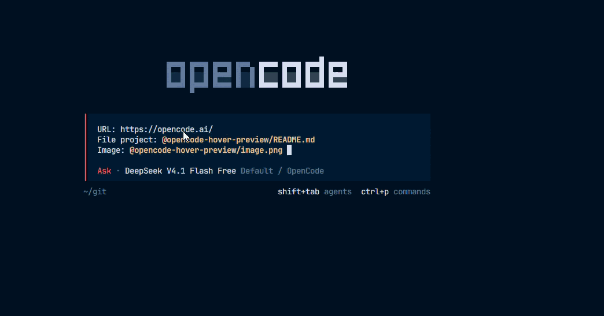
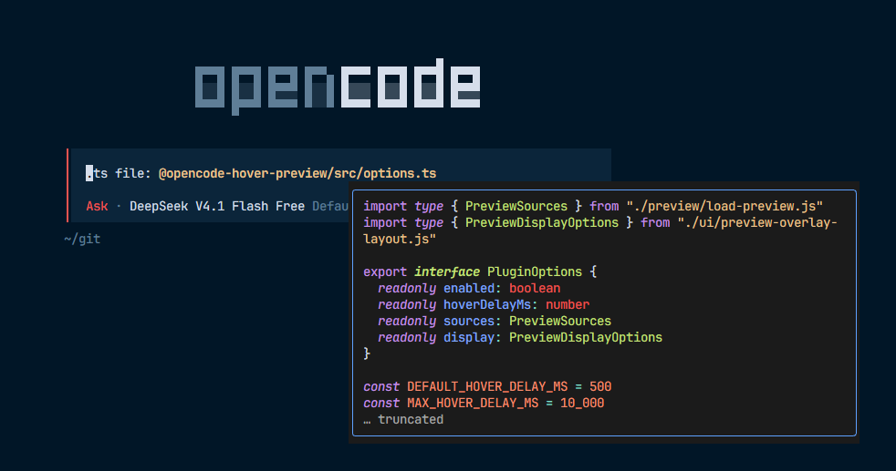

# OpenCode Hover Preview

[](https://www.npmjs.com/package/@jfrz38/opencode-hover-preview)
[](https://github.com/jfrz38/opencode-hover-preview/actions/workflows/ci.yml)
[](https://github.com/jfrz38/opencode-hover-preview/blob/main/LICENSE)
[](https://www.npmjs.com/package/@jfrz38/opencode-hover-preview)

Preview files, images, and public URLs without leaving OpenCode.

OpenCode Hover Preview adds contextual previews to the OpenCode terminal UI.
Rest the pointer on a supported target to inspect it without opening another
application or leaving the current session.



## Install

OpenCode Hover Preview requires OpenCode 2 and a terminal with mouse input.

Install the latest published package globally:

```sh
opencode plugin add @jfrz38/opencode-hover-preview@latest
```

Alternatively, add the package to your OpenCode TUI configuration:

```json
{
  "$schema": "https://opencode.ai/v2/cli.json",
  "plugins": [
    {
      "package": "@jfrz38/opencode-hover-preview",
      "options": {}
    }
  ]
}
```

Run `/reload` after changing the plugin configuration.

To verify the installation, open a workspace in OpenCode and rest the pointer
for half a second on either:

- a public URL such as `https://opencode.ai`;
- a workspace file mention such as `@README.md`.

A preview overlay should appear next to the target.

## Supported previews

| Target | Preview |
| --- | --- |
| Public HTTP(S) URL | Page title and description |
| `@file` mention | Formatted workspace file excerpt |
| Markdown link to a workspace file | Formatted workspace file excerpt |
| Local image mention or Markdown link | Bounded PNG, JPEG, GIF, or WebP image |
| Direct public HTTP(S) image URL | Bounded PNG, JPEG, GIF, or WebP image |

Markdown files render as terminal Markdown. Other text files use OpenTUI's
syntax highlighter when it recognizes the extension and remain readable as
plain text otherwise.



## Configure

The default configuration enables every preview source and uses a compact
overlay:

```json
{
  "$schema": "https://opencode.ai/v2/cli.json",
  "plugins": [
    {
      "package": "@jfrz38/opencode-hover-preview",
      "options": {
        "enabled": true,
        "hoverDelayMs": 500,
        "sources": {
          "url": true,
          "file": true,
          "image": true
        },
        "display": {
          "showDetails": false,
          "width": 70,
          "height": 16,
          "image": {
            "allowUpscale": false
          }
        }
      }
    }
  ]
}
```

| Option | Default | Description |
| --- | --- | --- |
| `enabled` | `true` | Enables the plugin. |
| `hoverDelayMs` | `500` | Delay before loading a preview, clamped from `0` to `10000` milliseconds. |
| `sources.url` | `true` | Previews public HTTP(S) pages. |
| `sources.file` | `true` | Previews workspace text files. |
| `sources.image` | `true` | Previews supported local and remote images. |
| `display.showDetails` | `false` | Shows paths, hosts, sanitized URLs, and other target metadata. |
| `display.width` | `70` | Preferred overlay width in terminal columns. |
| `display.height` | `16` | Preferred overlay height in terminal rows. |
| `display.image.allowUpscale` | `false` | Allows images to grow beyond their original pixel dimensions when terminal pixel information is available. |

The overlay automatically shrinks when the terminal is smaller. Width and
height accept positive integers; fractional values are rounded down and values
below the renderable minimum are raised.

Image previews remain controlled by `sources.image` even when `sources.url` or
`sources.file` is disabled. Set both `sources.url` and `sources.image` to
`false` to prevent network access. Set both `sources.file` and `sources.image`
to `false` to prevent workspace file reads.

## Compatibility and limitations

The plugin integrates with OpenCode 2 through OpenTUI mouse handling because
OpenCode does not expose a public inline-hover API. Changes in OpenCode or
OpenTUI may therefore require a plugin update.

Preview availability depends on the target information retained by OpenCode:

- Links cannot be previewed when their destination is no longer available.
- Plain local paths are not detected; use an `@file` mention or a Markdown
  link.
- Attachment placeholders such as `[Image N]` and pasted-content placeholders
  cannot be mapped to their original content.
- Image rendering depends on terminal capabilities, and GIF animation is not
  guaranteed.

OpenCode's native image-preview settings handle attachments independently of
this plugin.

## Security boundaries

The plugin reads workspace files and makes network requests only for the
preview sources you enable.

- File previews remain inside the current workspace, including after resolving
  symbolic links.
- Text previews inspect only the beginning of a file and show at most 20 lines
  or 4,000 characters.
- Local and remote images are limited to 10 MiB and validated by their binary
  signature.
- Network previews accept only public HTTP(S) URLs on standard ports, validate
  each redirect, and time out after three seconds.
- Remote HTML is limited to 256 KiB and parsed as text without executing it.

DNS validation reduces accidental access to local services but is not a
complete defense against DNS rebinding. Localhost and private-network URLs are
not supported.

## Development

This project uses Bun 1.4.4. Install dependencies and run all checks:

```sh
make install
make check
```

Run type validation or tests separately:

```sh
make build
make test
```

`make build` checks TypeScript types without emitting artifacts. Pull requests
to `develop` and `main` run the same checks in CI.

## License

OpenCode Hover Preview is available under the [MIT License](LICENSE).
